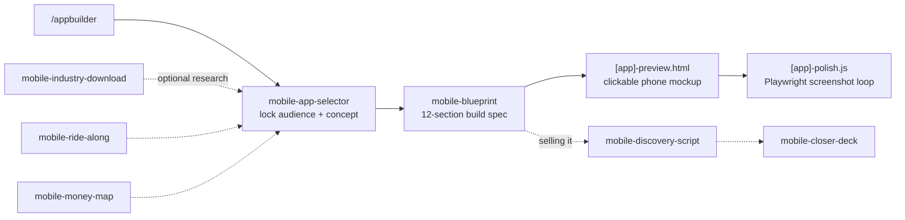

# App Builder

> Unofficial community project. Not affiliated with, endorsed by or sponsored by Anthropic. "Claude" and "Claude Code" are trademarks of Anthropic, PBC.

Claude Code skills that take a mobile app from a vague idea to a build spec you can hand
straight to Claude and start coding. Solo-buildable, no dev team.

Default stack: **React Native + Expo + Supabase + EAS Build**.

## How it works



1. **`/appbuilder`** asks a few questions and does the research inline.
2. **`mobile-app-selector`** narrows it to one locked sentence: who it's for and what it does.
3. **`mobile-blueprint`** turns that sentence into a 12-section spec: features, user stories,
   data model, screen map, numbered build sessions, acceptance criteria, App Store submission.
4. It writes a **self-contained HTML preview** of every screen in a phone frame, plus a
   **Playwright script** that screenshots each screen and flags overflow. Iterate until it passes.

The depth tools are optional. Run them first when you want a stronger concept:

| Skill | What it gives you |
|---|---|
| `mobile-industry-download` | Market and competitor landscape: ratings, review complaints, what users pay for, App Store gaps |
| `mobile-ride-along` | A day-in-the-life narrative of the target user, written to surface friction |
| `mobile-money-map` | Ranks candidate problems and picks the one worth building |
| `mobile-discovery-script` | A validation call script for talking to real users or a client |
| `mobile-closer-deck` | A one-page HTML deck for pitching the build |

## Install

```bash
git clone https://github.com/DimeDataCloud/app-builder
cp -r app-builder/skills/* ~/.claude/skills/
cp app-builder/.claude/commands/appbuilder.md ~/.claude/commands/
```

Then in Claude Code: `/appbuilder`.

`CLAUDE.md` is the reference card for the whole suite. Drop it in a project if you want the
rules loaded every session.

## Credits

The research → money-map → discovery → closer sequence is adapted from a public
"first client" Claude skill bundle. The skills here are rewritten for mobile apps.

## License

MIT. Built by [Dime Data](https://dimedata.cloud).
