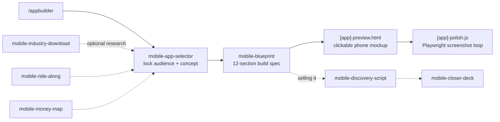

<div align="center">

# App Builder

Claude Code skills that take a mobile app from a vague idea to a build spec you can hand straight to Claude and start coding.

[](LICENSE)

</div>

> Unofficial community project. Not affiliated with, endorsed by or sponsored by Anthropic. "Claude" and "Claude Code" are trademarks of Anthropic, PBC.

App Builder is a set of Claude Code skills for solo builders. It locks one concept, writes an execution-ready specification for it, produces a clickable HTML preview of every screen, and gives you tools to research the market and validate the idea with real users or buyers.

Default stack: **React Native, Expo, Supabase, Expo push notifications and EAS Build**.

## Features

- Locks an audience and a concept into one sentence, scored against four gates: Demand, Buildability, Differentiability and Passion.
- Writes a 12-section build specification: concept, users, MVP features, user stories, data model, tech stack, integrations, screen map, numbered build sessions, acceptance criteria, launch criteria and App Store submission.
- Writes a self-contained HTML preview (`[app-slug]-preview.html`) that shows every screen in a phone frame, with working navigation and Playwright-friendly attributes. It opens in any browser without a server.
- Prints a Playwright script (`[app-slug]-polish.js`) that screenshots every screen and reports overflow, for a patch-and-check loop.
- Optional research skills for market, user and problem analysis, plus interview and pitch generators for after the build.

## How it works



1. **`/appbuilder`** asks a few questions in one batch and runs the research in parallel.
2. **`mobile-app-selector`** narrows the idea to one locked sentence in the form "I am building a [type] app for [specific user] that [solves specific problem]."
3. **`mobile-blueprint`** turns the sentence into the 12-section spec and writes the HTML preview.
4. The blueprint prints a Playwright polish script. Run it, review the screenshots and patch the preview until every screen passes.

## Skills

| Skill | Stage | What it does |
|---|---|---|
| `mobile-app-selector` | Core | Locks the audience, then the concept, and scores it against the four gates |
| `mobile-blueprint` | Core | Writes the 12-section build spec and the HTML preview |
| `mobile-industry-download` | Optional research | Market and competitor landscape: ratings, review complaints, what users pay for, gaps |
| `mobile-ride-along` | Optional research | A day-in-the-life narrative of the target user that surfaces friction |
| `mobile-money-map` | Optional research | Ranks candidate problems against the mobile problem types and hard filters, then picks one |
| `mobile-discovery-script` | After the build | Interview questions for consumer users, or a sales call script for enterprise buyers |
| `mobile-closer-deck` | After the build | A six-slide HTML deck for a beta launch or an enterprise close |

Run the research skills before `mobile-app-selector` when you want a stronger concept. `/appbuilder` also does a lighter version of the research inline.

### The four gates

Each concept is scored 1 to 5 on each gate, out of 20 in total:

- **Demand:** real complaints exist and users spend on adjacent tools (research required).
- **Buildability:** feasible in React Native and Expo in one to three weeks (judgement).
- **Differentiability:** a real gap in the App Store, not a crowded market (research required).
- **Passion:** you could run 90 days of user calls without dreading them (your judgement).

A total of 17 to 20 is a green light. 13 to 16 is workable, and any gate scored 2 or below needs watching. 9 to 12 means fix a gate first. Below 9, pick another idea. A single gate scored 1 is an automatic veto.

## Requirements

- [Claude Code](https://docs.claude.com/en/docs/claude-code) with access to the skills.
- Node.js and Playwright, only for the polish loop that checks the HTML preview.
- The web search tool, for the research gates.

## Install

```bash
git clone https://github.com/DimeDataCloud/app-builder
cp -r app-builder/skills/* ~/.claude/skills/
cp app-builder/.claude/commands/appbuilder.md ~/.claude/commands/
```

Then, in Claude Code, run `/appbuilder`. You can add an idea in words after the command, for example `/appbuilder a habit tracker for nurses`.

`CLAUDE.md` is the reference card for the whole suite. Copy it into a project if you want its rules loaded in every session.

## Repository structure

```
CLAUDE.md                                  rules, frameworks and the core path, loaded per project
.claude/commands/appbuilder.md             the /appbuilder command: intake, research and hand-off
skills/mobile-app-selector/                SKILL.md and references/research-playbook.md
skills/mobile-blueprint/SKILL.md           the 12-section spec and the HTML preview
skills/mobile-industry-download/SKILL.md   market research
skills/mobile-ride-along/SKILL.md          user narrative
skills/mobile-money-map/SKILL.md           problem ranking
skills/mobile-discovery-script/SKILL.md    interview and sales call scripts
skills/mobile-closer-deck/SKILL.md         launch and close decks
```

## Status

The skills are instructions for Claude Code. They have no build or test pipeline. Quality is checked by running them end to end on a real idea and reviewing the output.

## Contributing

This is a public project from Dime Data. Suggestions and bug reports are welcome as GitHub issues. Please keep changes to the skill text consistent with the rules in `CLAUDE.md`.

## Credits

The research, money-map, discovery and closer sequence is adapted from a public "first client" Claude skill bundle. The skills here are rewritten for mobile apps.

## License

MIT. See [LICENSE](LICENSE). Copyright (c) 2026 Dime Data.

Built by [Dime Data](https://dimedata.cloud).
